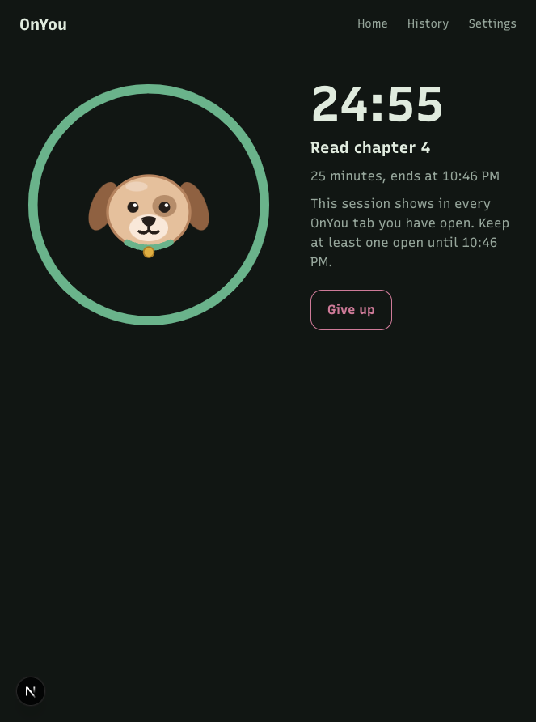
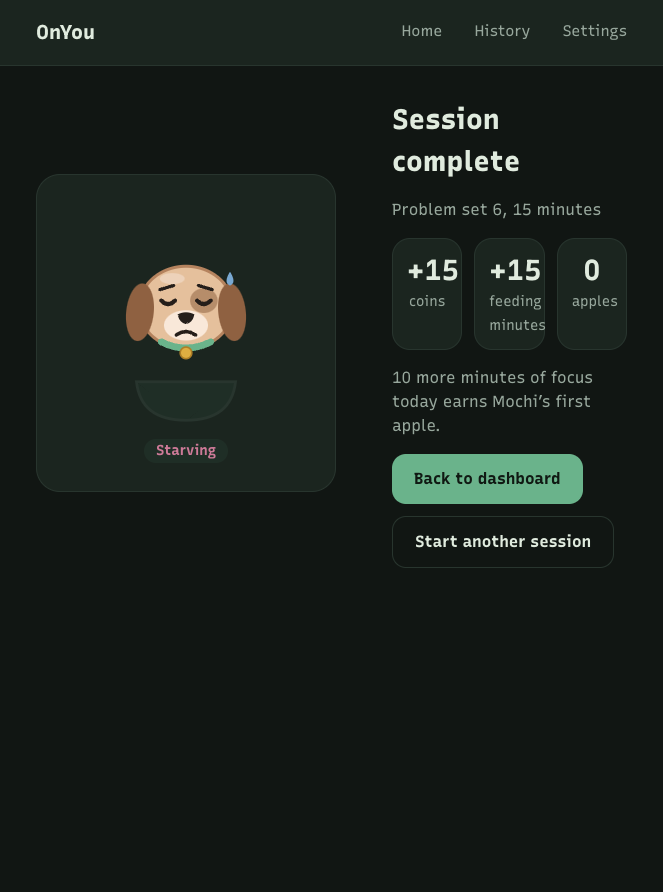
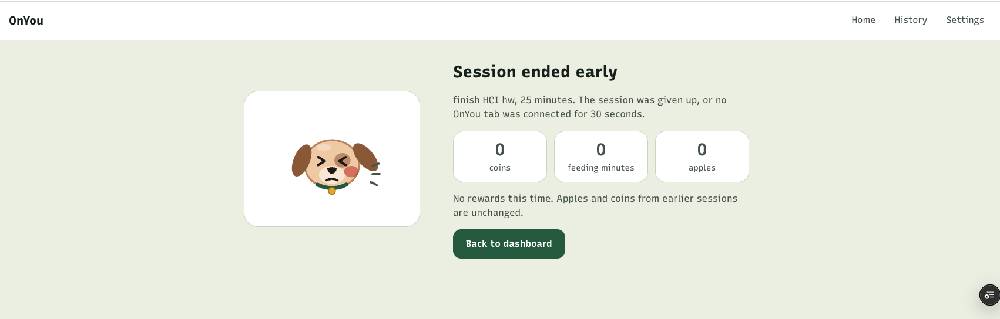

# OnYou

**Turn focus time into care for a virtual pet.** OnYou is a web app for students doing self-directed study or work. Name a task, pick 15, 25, or 50 minutes, and keep an OnYou tab open until the timer ends. Finishing earns coins and feeds your pet, Mochi. Giving up earns nothing, and Mochi gets a gentle slap.

**Live app:** <https://onyou123.vercel.app> · **API docs:** [docs/api.md](docs/api.md) and Swagger UI at [/docs](https://onyou123.vercel.app/docs) · **Setup and deployment:** [docs/setup-and-deployment.md](docs/setup-and-deployment.md)

| Focus session | Session complete | Session ended early |
| --- | --- | --- |
|  |  |  |

## Contents

- [How OnYou works](#how-onyou-works)
- [Features](#features)
- [Tech stack](#tech-stack)
- [Architecture](#architecture)
- [Quick start](#quick-start)
- [Scripts](#scripts)
- [Testing](#testing)
- [Project structure](#project-structure)
- [Documentation](#documentation)
- [Team and workflow](#team-and-workflow)

## How OnYou works

- **Every account gets a pet named Mochi**, who starts each day Starving.
- **Focus sessions** last 15, 25, or 50 minutes. One session runs per account at a time, shown the same in every signed-in tab.
- **Presence:** each open OnYou tab sends a heartbeat every 10 seconds. If no tab checks in for 30 seconds before the timer ends, the session ends with no rewards. Switching tabs or apps is fine.
- **Rewards** (finished sessions only):
  - **Coins:** 1 per minute. They keep adding up and never reset.
  - **Apples:** every 25 minutes of finished focus in a day feeds Mochi one apple, up to 2 a day. 0 apples is Starving, 1 is Hungry, 2 is Full. Minutes past 50 a day don't count toward apples.
- **Each day starts fresh** at midnight in the timezone saved at signup: apples and feeding minutes reset, coins stay, and a missed day never hurts Mochi.
- **The server decides every outcome** from stored timestamps; the browser countdown is only a display. Rewards are applied exactly once.

The full rules are in [OnYou_PRD_v2_9.md](OnYou_PRD_v2_9.md); screen layout and pet art are in [OnYou_web_mockups.html](OnYou_web_mockups.html).

## Features

Everything below is on `main` and deployed to production.

| Area | What it does | Issues |
| --- | --- | --- |
| Accounts | Signup, login, and logout; a session lasts 7 days in an HttpOnly cookie. Login errors never reveal which field was wrong | #8, #9 |
| Password reset | Forgot password emails a single-use link (Resend) that expires in 30 minutes; rate limited by email and IP; resetting signs out every device | #24, #25 |
| Pet | Mochi is created with the account; rename in Settings (blank restores Mochi) | #10 |
| Home | Pet card with Starving, Hungry, or Full art and label, apples today, progress to the next apple, coins, and the active-session bar | #19, #20 |
| Focus | Task name, 15/25/50-minute picker showing what each duration earns today, countdown from the server end time, heartbeats across tabs, refresh restore, connection warning | #12, #13, #14, #72 |
| Outcomes | Completion with exactly-once rewards and a result screen; Give up with confirmation and a slap; logout during a session ends it after confirmation | #15, #16, #17, #18 |
| History | Every finished session, newest first, 20 per page with Load more and an empty state | #22, #23 |
| Settings | Pet name, account email, and Log out | #10, #18 |
| Accessibility | WCAG 2.2 AA contrast, keyboard focus, labelled inputs, dialogs that trap focus and close with Escape (bottom sheets on phones), reduced-motion support; tested at 390px and 1040px | #30 |

Out of scope by design: spending coins, shops, pause and resume, custom durations, social login, and native apps.

## Tech stack

| Area | Technology |
| --- | --- |
| Language and runtime | TypeScript 5 (`strict`), Node.js 22 |
| App | Next.js 16 App Router (Server Components by default), React 19, Tailwind CSS 4 |
| Data | PostgreSQL 16 on Neon, Prisma 7 with `@prisma/adapter-pg` |
| Auth and validation | `jose` (HS256 JWT in an HttpOnly cookie), `bcrypt`, Zod 4 shared by client and server |
| Email | Resend (password reset only) |
| Tests | Vitest 5, React Testing Library, Playwright |
| Quality and hosting | ESLint, Prettier, GitHub Actions (CI, CodeQL, `npm audit`), Dependabot, Vercel |
| API docs | OpenAPI 3.1 ([docs/openapi.yaml](docs/openapi.yaml)) with Swagger UI at `/docs` |

## Architecture

```text
Browser (Next.js UI) ──► src/lib/api (typed fetch helpers)
                          ──► Route Handlers in src/app/api   (Zod-parse, authenticate, call one service)
                               ──► Services in src/lib/server  (transactions, Prisma, Resend)
                                    ──► Pure rules in src/lib/domain (rewards, presence, feeding day; no I/O, no clock)
                                    ──► PostgreSQL (Neon)
```

- Dependencies point one way only, down this chain. Business rules live in `src/lib/domain` and take the current time as an argument, so they are fully unit-tested.
- Session status and rewards change in one conditional transaction, so retries and simultaneous tabs never pay twice.
- Heartbeats are plain authenticated HTTP requests; there are no WebSockets.

Diagrams: [docs/diagrams/architecture.md](docs/diagrams/architecture.md) and [docs/diagrams/database-schema.md](docs/diagrams/database-schema.md). Engineering rules: [AGENTS.md](AGENTS.md).

## Quick start

You need Node.js 22 and PostgreSQL 16 (Docker works). The [setup and deployment guide](docs/setup-and-deployment.md#local-setup) has every step, including the Docker commands.

```bash
git clone https://github.com/venuschen999/OnYou.git
cd OnYou
npm ci
cp .env.example .env          # set DATABASE_URL and JWT_SECRET (openssl rand -base64 32)
npx prisma migrate deploy
npm run dev                   # http://localhost:3000
```

Environment variables are explained in the [guide](docs/setup-and-deployment.md#environment-variables); [`.env.example`](.env.example) lists their names.

## Scripts

| Script | What it does |
| --- | --- |
| `npm run dev` | Development server |
| `npm run build` / `npm run start` | Production build and server (the build does not migrate) |
| `npm run vercel-build` | What Vercel runs: `prisma migrate deploy && next build` |
| `npm run lint` / `npm run typecheck` | ESLint / `next typegen && tsc --noEmit` |
| `npm run format` / `npm run format:check` | Prettier |
| `npm test` | Unit and component tests |
| `npm run test:coverage` | Coverage gate (overall lines ≥ 80%, domain ≥ 95%) |
| `npm run test:integration` | Integration tests against PostgreSQL (needs `TEST_DATABASE_URL`) |
| `npm run test:e2e` | Playwright end-to-end tests |

## Testing

| Level | Where | Covers |
| --- | --- | --- |
| Unit | `tests/unit/domain`, `tests/unit/server`, `tests/unit/validation` | Rewards, presence, feeding day, reward hints, rate limits, tokens, schemas |
| Component | `tests/unit/components`, `tests/unit/app` | Screens, dialogs, forms, contrast and route-state guards |
| Integration | `tests/integration` | Every route handler against real PostgreSQL: auth, ownership, error shapes, transactions, concurrency, midnight and late resolution |
| End-to-end | `e2e/` | Signup, the dashboard, complete, give up, a second tab, history, and layout at 390px and 1040px on every screen |

Features were built test-first (red, green, refactor), and each pull request records its runs. CI runs every level on every pull request.

## Project structure

```text
src/
  app/(auth)/        login, signup, forgot-password, reset-password
  app/(app)/         dashboard (Home), focus, history, settings, each with loading and error states
  app/api/           Route Handlers (HTTP only)
  components/        feature UI; components/ui/ holds Button, Input, Modal, Spinner, ErrorMessage
  hooks/             session controller, heartbeat, countdown, history list
  lib/domain/        pure business rules
  lib/server/        Prisma, auth, email, services
  lib/validation/    Zod schemas shared by forms and handlers
  lib/api/           typed browser fetch helpers
prisma/              schema.prisma and committed migrations
tests/               unit/, integration/, factories/, fixtures/
e2e/                 Playwright specs
docs/                API reference, setup guide, OpenAPI, diagrams, decisions, sprint records
```

## Documentation

| Document | What it is |
| --- | --- |
| [docs/api.md](docs/api.md) | API reference: authentication, errors, and every endpoint with examples |
| [docs/setup-and-deployment.md](docs/setup-and-deployment.md) | Local setup, environment variables, tests, Vercel and Neon deployment, migrations, troubleshooting |
| [docs/openapi.yaml](docs/openapi.yaml) | OpenAPI 3.1 specification (Swagger UI at `/docs`) |
| [docs/diagrams/](docs/diagrams/) | Architecture and database schema diagrams |
| [docs/agent-memory/](docs/agent-memory/README.md) | Product and technical decisions made during development, by feature |
| [docs/sprints/](docs/sprints/) | Sprint retrospectives and the repository's contribution summary |
| [docs/demo/demo-script.md](docs/demo/demo-script.md) | Demo walkthrough |
| [OnYou_PRD_v2_9.md](OnYou_PRD_v2_9.md) | Product requirements |
| [OnYou_web_mockups.html](OnYou_web_mockups.html) | Screen layout, copy, and pet art |
| [AGENTS.md](AGENTS.md) | Engineering rules for people and coding agents |

Older PRDs and rules under `docs/archive/` are historical, not current instructions.

## Team and workflow

OnYou was built by **venuschen999** and **CollinsCao** over two sprints.

- **Scrum board:** issues move Backlog → Sprint Todo → In Progress → In Review → Done on the GitHub project.
- **Branches:** one issue per branch (`feature/12-start-session-api`), always into `main` through a pull request.
- **Merging:** green CI, a working Vercel preview, and the other partner's approval; regular merges, no squash, so test-first history stays visible.
- **AI assistance:** both partners used coding agents (Claude Code and Cursor) under [AGENTS.md](AGENTS.md); each pull request has an AI-usage note.
