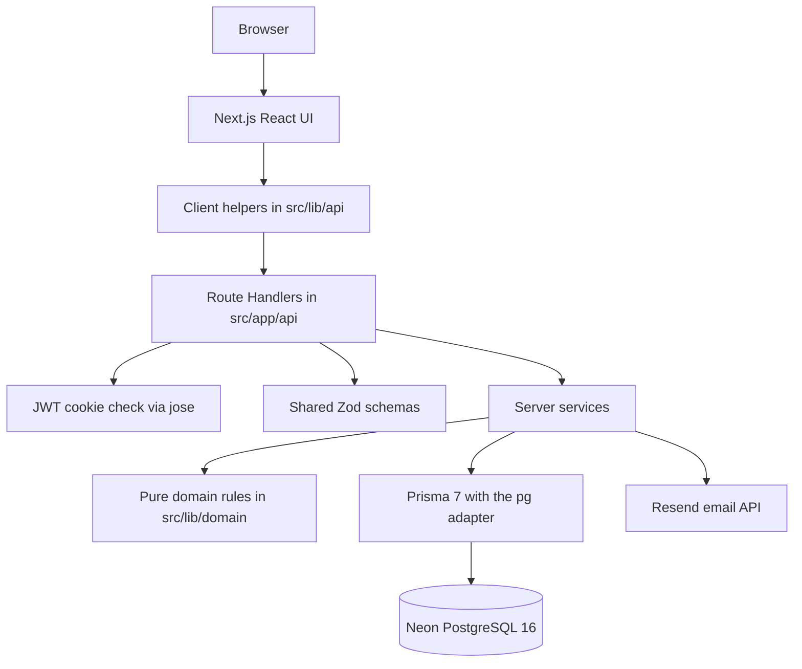
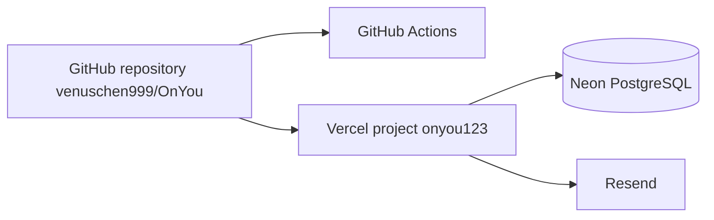

# Architecture

This diagram describes the application on `main` at `531ec68`. It follows the dependency direction in [AGENTS.md](../../AGENTS.md) section 3 and the route handlers in `src/app/api`. Issue #28 asked for this file under `docs/`. An architecture image was attached to that issue on 2026-11-16 and was not committed here.

Runtime request path:

Hosting and checks sit outside that request path:

## Request path

The browser renders the Next.js App Router UI. Authenticated pages are Home (`src/app/(app)/dashboard`), Focus, History, and Settings. Signed-out pages are login, signup, forgot password, and reset password. Client components call the typed helpers in `src/lib/api` (`auth.ts`, `pet.ts`, `sessions.ts`). `useHeartbeat` sends `POST /api/sessions/{id}/heartbeat` on an interval. That call is ordinary HTTP. The app does not use a WebSocket library.

Route Handlers parse input with the shared Zod schemas, read the auth cookie, call one service, and return JSON. Business rules stay out of the handlers.

`src/lib/server/authToken.ts` signs and verifies an HS256 JWT with `jose`. The cookie name is `onyou_auth`. It is HttpOnly, Secure, and SameSite=Lax. The subject is the user id. The `tv` claim is `User.tokenVersion`. Password reset increments that version, so older tokens no longer match. There is no OAuth provider and no server-side session table.

Services in `src/lib/server` own database transactions:

| Service | Role |
| --- | --- |
| `authService.ts` | Signup and login. Signup creates the user and the default pet in one transaction. |
| `passwordResetService.ts` | Reset request and confirm. Email is sent only from `passwordResetEmail.ts`. |
| `sessionService.ts` | Start, heartbeat, complete, abandon, active session, and history. Status and rewards change in one transaction. |
| `petService.ts` | Today's feeding progress and pet rename. |

`src/lib/domain` is pure. Rewards, feeding day, presence, give-up, history ordering, and pet progress take their inputs as arguments. Those modules do not import Prisma, read the environment, or call `Date.now()`.

`src/lib/server/db.ts` is the one Prisma client. It uses `@prisma/adapter-pg` and `DATABASE_URL`. Prisma 7 reads the migration URL from `prisma.config.ts`, which prefers `DATABASE_URL_UNPOOLED` when that value is set.

## External services that are actually used

| Service | Where it is used |
| --- | --- |
| Vercel project `onyou123` | Hosts the Next.js app. Production deploys from `main`. Other branches get preview deployments. The build command is `prisma migrate deploy && next build`. |
| Neon PostgreSQL 16 | Application data. Preview deployments use a Neon branch. Production uses the Neon main branch. |
| Resend | `POST https://api.resend.com/emails` from `passwordResetEmail.ts`, and only for password reset. |
| GitHub Actions | Pull-request checks: lint, typecheck, unit tests, coverage, integration tests against PostgreSQL 16, Playwright, CodeQL, and `npm audit`. Actions is not on the user request path. |

The repository does not call a shop, a push-notification service, an OAuth identity provider, or a WebSocket host.
