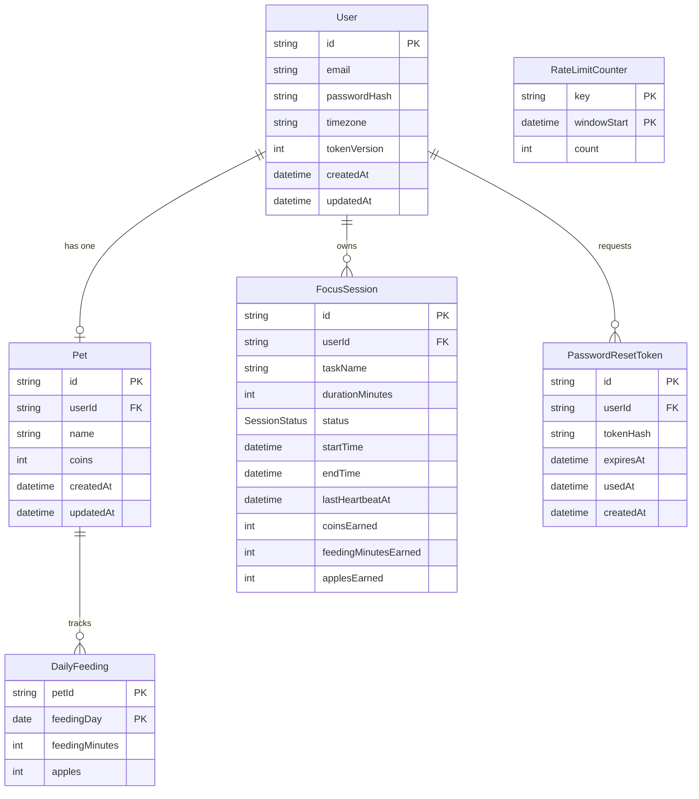

# Database schema

The diagram matches `prisma/schema.prisma` and the committed SQL in `prisma/migrations`. Issue #28 asked for this file under `docs/`. No schema drawing was stored in the repository before this document.

PostgreSQL is the only database. Timestamps are `timestamptz` (UTC). Prisma 7 does not store a connection URL in the schema file.

`RateLimitCounter` is in the schema and has no foreign key. It is not a child of `User`. The entity is drawn beside the account tables so the table is not omitted.

## Models

Column types below are the Prisma fields. Database types are in the migration SQL (`VarChar`, `Timestamptz`, `Date`, `Char(64)`).

### User

| Field | Notes |
| --- | --- |
| `id` | Primary key, `cuid()` |
| `email` | `VarChar(254)`. Uniqueness is case-insensitive. See constraints. |
| `passwordHash` | bcrypt hash. Not returned by the API. |
| `timezone` | IANA zone saved at signup. |
| `tokenVersion` | Copied into the JWT as `tv`. Password reset increments it. Default 0. |
| `createdAt`, `updatedAt` | UTC |

Relations: optional `Pet`, many `FocusSession`, many `PasswordResetToken`.

### Pet

| Field | Notes |
| --- | --- |
| `id` | Primary key, `cuid()` |
| `userId` | Unique foreign key to `User.id`, `onDelete: Cascade` |
| `name` | `VarChar(30)`, default `Mochi` |
| `coins` | Default 0. Coins only increase. |
| `createdAt`, `updatedAt` | UTC |

Relation: many `DailyFeeding`.

### FocusSession

| Field | Notes |
| --- | --- |
| `id` | Primary key, `cuid()` |
| `userId` | Foreign key to `User.id`, `onDelete: Cascade` |
| `taskName` | `VarChar(80)` |
| `durationMinutes` | Integer. Database check allows only 15, 25, or 50. |
| `status` | Enum `SessionStatus`: `ACTIVE`, `COMPLETED`, `ABANDONED`. Default `ACTIVE`. |
| `startTime`, `endTime`, `lastHeartbeatAt` | UTC. Set by the server. |
| `coinsEarned`, `feedingMinutesEarned`, `applesEarned` | Integers, default 0. |

Index: `(userId, startTime DESC)` for history.

### DailyFeeding

| Field | Notes |
| --- | --- |
| `petId` | Foreign key to `Pet.id`, `onDelete: Cascade`. Part of the primary key. |
| `feedingDay` | `Date`. Part of the primary key. |
| `feedingMinutes` | Default 0 |
| `apples` | Default 0 |

One row per pet per feeding day. A missing row means 0 minutes and 0 apples. There is no separate id column.

### PasswordResetToken

| Field | Notes |
| --- | --- |
| `id` | Primary key, `cuid()` |
| `userId` | Foreign key to `User.id`, `onDelete: Cascade` |
| `tokenHash` | `Char(64)`, unique. SHA-256 of the emailed token. |
| `expiresAt` | UTC |
| `usedAt` | UTC, nullable |
| `createdAt` | UTC |

Index: `userId`.

### RateLimitCounter

| Field | Notes |
| --- | --- |
| `key` | `VarChar(100)`. Part of the primary key. |
| `windowStart` | UTC. Part of the primary key. |
| `count` | Default 0 |

No relation to `User`. Password-reset rate limits use this table so counters are shared across server instances.

## Constraints that live in SQL

`prisma/migrations/20261104032824_init/migration.sql` adds three rules the Prisma schema cannot express by itself:

- Unique index `FocusSession_one_active_per_user` on `FocusSession(userId)` where `status = 'ACTIVE'`.
- Unique index `User_email_lower_key` on `LOWER(email)`.
- Check `FocusSession_durationMinutes_check`: `durationMinutes IN (15, 25, 50)`.

`prisma/migrations/20261115235400_password_reset/migration.sql` adds `PasswordResetToken`, `RateLimitCounter`, and the unique index on `tokenHash`.

## Tables that are not in this database

There is no session-token table, no OAuth account table, no shop table, and no partner or invite table. Focus-session completion does not store a token hash.
